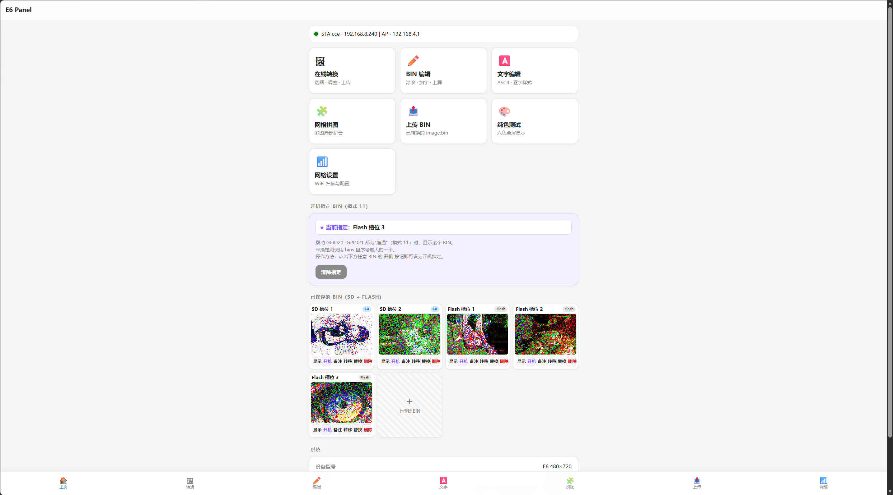
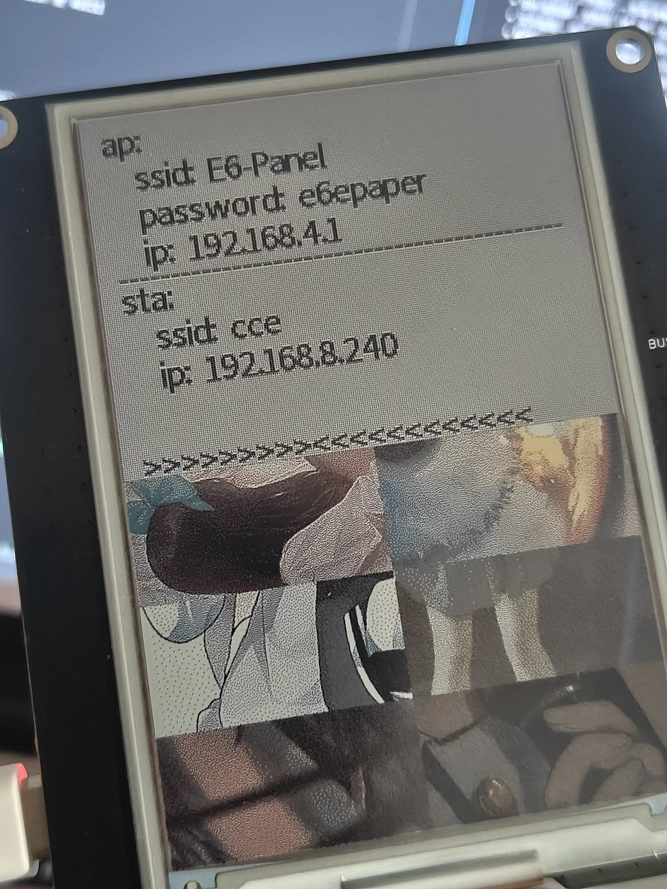
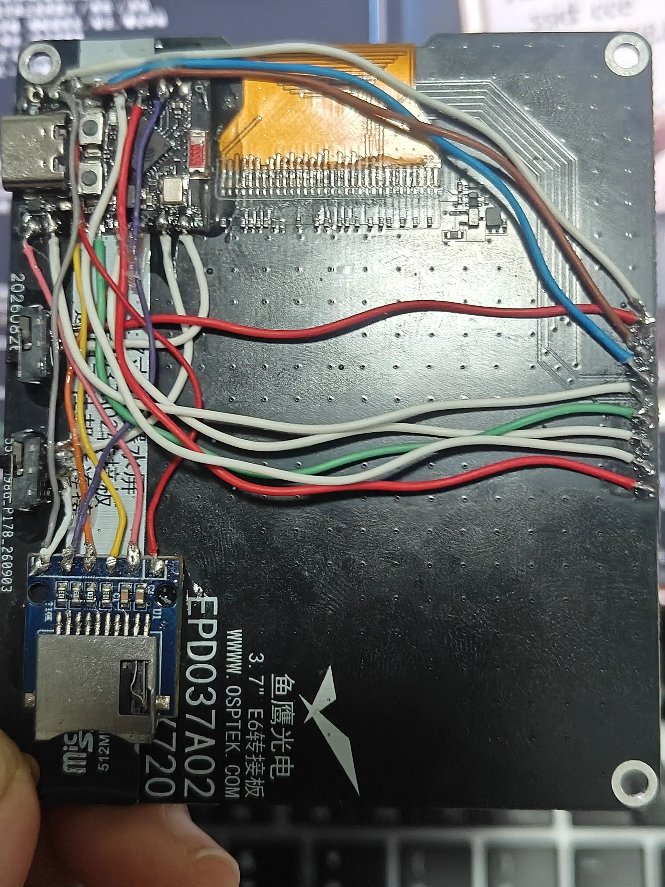

# ESP32-C3 SuperMini + JD7601 6色墨水屏面板

**ESP32-C3 SuperMini** 驱动 **JD7601 六色电子墨水屏（480×720）** 的完整控制面板。全部运行在 **MicroPython** 上，浏览器完成图片处理，设备只接收打包好的 4bpp 帧数据。

ESP32-C3 SuperMini + JD7601 6-color e-paper (480×720, Spectra 6) control panel running MicroPython. Image processing happens in the browser; the device only receives pre-packed 4bpp frames.

<p align="center">
  
  
  
</p>

| Web 主界面 | 屏幕显示效果 | 硬件接线 |
|:---:|:---:|:---:|
|  |  |  |

## 目录

- [功能特性](#功能特性)
- [硬件要求](#硬件要求)
- [快速开始](#快速开始)
- [开机模式](#开机模式)
- [Web 界面](#web-界面)
  - [等待时间一览](#等待时间一览)
  - [通用操作提示](#通用操作提示)
  - [各页面操作要点](#各页面操作要点)
- [项目结构](#项目结构)
- [扩展文档](#扩展文档)
- [常见问题](#常见问题)
- [许可证](#许可证)
- [致谢](#致谢)

## 功能特性

- **图片转换**— 上传图片 → 色调/清晰度/范围适配 → 6 色抖动（13 种内核）→ 一键上屏
- **BIN 编辑器**— 双图层（导入层 + 绘制层），画笔、橡皮、吸管、纯色 + 45 种伪色
- **文字编辑**— 逐字符样式（粗体/斜体/描边/伪色），多选批量，字间距，逐行行距，四向旋转
- **网格拼图**— 8×8 网格，每格可独立选择图片 / 纯色 / 伪色
- **BIN 库**— Flash + SD 卡双存储，缩略图预览，备注，槽位转移
- **WiFi 配置**— 网页端扫描、保存、优先级管理
- **四种开机模式**— 双拨动开关 GPIO20/21 组合，开机自动执行
- **字体系统**— v4 chunk 格式 + 索引懒加载，SD 卡放中文，Flash 放 ASCII

## 硬件要求

| 元件 | 规格 |
| --- | --- |
| 主控 | LOLIN C3 MINI（ESP32-C3FH4，4MB Flash，400KB SRAM） |
| 屏幕 | JD7601 六色墨水屏，480×720，Spectra 6 |
| 存储 | MicroSD 卡（FAT32） |
| 开关 | 拨动开关 × 2（接 GPIO20/21，另一端接 GND） |

**引脚速查**

| 设备 | 引脚 |
| --- | --- |
| 屏幕（SoftSPI） | SCK=4, MOSI=6, CS=3, DC=9, RST=8, BUSY=2 |
| SD 卡（HW SPI slot=2） | SCK=10, MOSI=7, MISO=1, CS=5 |
| 拨动开关 | GPIO20 / GPIO21 → GND |

GPIO20/21 默认是 UART0 的 RX/TX。使用原生 USB Serial JTAG 做 REPL 时这两个引脚空闲可用；使用 UART 桥接板时不可用。完整接线、电源、UART 冲突分析见 **[hardware.md](docs/hardware.md)**。

## 快速开始

**1. 烧录 MicroPython v1.28.0**

```
esptool.py --chip esp32c3 --port <PORT> erase_flash
esptool.py --chip esp32c3 --port <PORT> write_flash -z 0x0 ESP32_GENERIC_C3-1.28.0.bin
```

**2. 上传设备端代码**

```
cd esp/
mpremote cp boot.py main.py boot_screen.py jd7601.py sd_helper.py \
              mosaic.py text_renderer.py text_console.py \
              web_server.py wifi_manager.py build_font_index.py :
mpremote cp -r www/ :/www/
```

**3. 生成基础字体**

```
python gen_font.py <你的字体.ttf> --charset=ascii --sizes=32 \
    --family=base --format=v4 --out=esp/www/fonts
mpremote cp -r esp/www/fonts/ :/www/fonts/
```

中文等其他字体见 **[font-format.md](docs/font-format.md)**。

**4. 生成字体索引（设备上跑一次）**

```
>>> import build_font_index
>>> build_font_index.build()
```

**5. 重启设备**

```
>>> import machine
>>> machine.reset()
```

REPL 会打印访问地址：

```
[MAIN] AP: http://192.168.4.1
[MAIN] STA: http://192.168.8.240
[MAIN] 启动 Web 服务器...
```

浏览器打开 AP 的`192.168.4.1`，或者同一网段访问 STA IP。

## 开机模式

| GPIO20 | GPIO21 | 模式 | 动作 | 显示顺序 |
| --- | --- | --- | --- | --- |
| 断开 | 断开 | 00 | 无动作 | 直接进 Web |
| 断开 | 连通 | 01 | 随机显示 BIN | 先显示 → 再连 STA |
| 连通 | 断开 | 10 | 显示网络信息 | 先连 STA → 后显示 |
| 连通 | 连通 | 11 | 显示指定 BIN | 先显示 → 再连 STA |

**语义**：`1 = 开关连通（短接到 GND）`。代码使用内部上拉`Pin.PULL_UP`，读到 0 表示连通。

模式 01/11 的启动时间比原来减半，因为显示 BIN 不需要先连上 WiFi。模式 10 需要 STA 的 IP 才能显示网络信息，所以顺序反过来。

**在 Web 首页设置"开机指定 BIN"**：点任意 BIN 的"开机"按钮，该槽位会被写进`/boot_cfg.json`。

时序细节、REPL 调试、指定 BIN 配置文件见 **[boot-modes.md](docs/boot-modes.md)**。

## Web 界面

| 路由 | 页面 | 主要功能 |
| --- | --- | --- |
| `/` | 主页 | 网络状态、BIN 库缩略图、开机指定 BIN、系统信息 |
| `/convert` | 图片转换 | 上传图片 → 抖动 → 下载 / 上传 / 保存到 BIN 库 |
| `/edit` | BIN 编辑器 | 双图层绘制、伪色、文字叠加 |
| `/text` | 文字编辑 | 逐字符样式、多选、字间距、行设置、背景图 |
| `/mosaic` | 网格拼图 | 2×2~8×8 网格，每格自由选源 |
| `/wifi` | WiFi 设置 | 扫描、保存、优先级 |
| （主页内切换） | 上传 BIN | 已转换的 `.bin` 文件上传 |
| （主页内切换） | 纯色测试 | 6 色全屏刷新 |

浏览器直接访问，无需安装客户端。所有图片处理在浏览器完成，设备只负责存储和显示。

### ⏱ 等待时间一览

墨水屏刷新本身很慢，所有涉及刷屏的操作都要等几十秒到两分钟。**点了之后盯着屏幕等，不要重复点击**。

| 操作 | 大概耗时 | 说明 |
| --- | --- | --- |
| 屏幕刷新（纯色 / BIN / 拼图） | 30~60 秒 | 墨水屏物理刷新时间 |
| 上传并显示 | 60~90 秒 | 含 172 KB 上传 + 刷屏 |
| 文字渲染（`/text` 应用到屏幕） | 屏幕 30~130 秒 | 字体大 / 字符多 / 加粗 / 描边会更慢 |
| 上传到 BIN 库（仅保存） | 10~30 秒 | 只上传不刷屏 |
| WiFi 扫描 | 3~5 秒 | — |
| 缩略图加载（有 `.thumb`） | 1~2 秒 | 新上传的 BIN 通常有 |
| 缩略图加载（无 `.thumb`） | 5~8 秒 | 旧 BIN 走设备端降采样 |
| 字体 chunk 下载 | 1~3 秒 | 100 KB 左右 |
| 字体索引生成 | 首次 1~2 分钟 | 只在添加字体后需要 |

### 通用操作提示

**1. 屏幕刷新期间不要重复点击。** 设备是单连接 HTTP 服务器，同一时刻只能处理一个请求。刷屏过程中重复点击会排队，最终导致请求超时，而屏幕已经在刷了——只是页面报错让你以为失败了。

**2. 刷屏期间不要开其他标签页操作。** 其他请求会挂起等到刷屏结束，超过浏览器超时时间后显示连接失败。

**3. `/text` 页面的"已发送渲染指令 ✓" ≠ "屏幕已刷新"。** 设备收到请求后立即返回 `started: true`，屏幕在后台慢慢渲染。看到这条提示后**自己盯着屏幕**，不要再点。

**4. 中文内容必须选 `[SD]` 开头的字体。** Flash 上的 `base_32_0.bin` 只包含 ASCII，中文会显示空白。字体下拉里 `[SD] sourcehan 32px` 之类的才含中文。

**5. 缩略图第一次慢是正常的。** 新上传的 BIN 有 `.thumb` 文件（1~2 秒），旧 BIN 没有（5~8 秒）。如果特别在意速度，重新上传一次旧 BIN 即可。

### 各页面操作要点

#### 主页 `/`

- **顶部网络徽章**：显示 AP / STA 的 SSID 和 IP
- **菜单卡片**：进入 6 个功能页面，以及"上传 BIN"和"纯色测试"两个内置页
- **开机指定 BIN**（紫色面板）：点击任意 BIN 卡片的"开机"按钮 → 写入 `/boot_cfg.json`，下次开机模式 11 显示它。再点一次取消，或点面板"清除指定"
- **BIN 库网格**：每张卡片有 6 个按钮 —— 显示（刷屏 30~60 秒）、开机、备注、转移（SD ↔ Flash）、替换、删除
- **底部系统信息**：SD / Flash 剩余空间，网络摘要

#### 图片转换 `/convert`

- 上传图片 → 左侧面板调整参数 → 右侧 4 个预览实时更新（输入 / 调整后 / 抖动后 / 设备）
- **抖动类型**：误差扩散（推荐）、有序、随机、量化、蓝噪声，误差扩散有 13 种内核可选
- **预设**：自动 / 手动 / 均衡 / 动态 / 鲜艳 / 柔和 / 灰度 / 还原 / 扫描海报。选"自动"会根据图片内容推荐
- **三个输出按钮**：
  - **下载 image.bin** — 纯下载，不碰设备
  - **上传并显示** — 上传并立即刷屏，**60~90 秒**
  - **上传到 BIN 库** — 保存到 SD/Flash 槽位，不刷屏，**10~30 秒**
- 点后两个按钮会先弹窗选择 Dithered（校准色）还是 Device（设备原生色）数据源

#### BIN 编辑器 `/edit`

- 双图层：导入层（读取的 BIN）+ 绘制层（你画的笔画），互不干扰
- **工具**：画笔、橡皮、吸管（区域取色）
- **笔刷大小**：2~32 像素
- **颜色**：6 基础色 + 45 种伪色（15 组 × 3 密度）
- **文字放置**：输入文字 → 选字体/字号/样式 → 点"放置文字" → 在画布上单击确定锚点
- **导入层锁定**：勾选后橡皮只擦绘制层，不动 BIN 内容
- 顶部"打开 BIN / 保存 BIN / 显示到屏幕"，显示会刷屏 **30~60 秒**

#### 文字编辑 `/text`

- 顶部内容输入（支持多行），下方是字符样式选择
- **字符多选**：单击选中一个、Shift 范围选中、Ctrl 切换单个、全选 / 反选 / 同字扩展
- **字间距**：全局 -30~+60 像素，逐字符可单独覆盖
- **行距**：0~3 倍（0 表示完全重叠）
- **逐行行距**：在"间距 / 行设置"里对每行单独 ±200 像素
- **背景图**：可选 SD/Flash 背景，旋转只作用于文字层
- **重新渲染**：只生成浏览器本地预览，不碰设备
- **应用到屏幕**：发给设备流式渲染。点后显示"已发送渲染指令 ✓"，**屏幕在 30~130 秒后刷新**

#### 网格拼图 `/mosaic`

- 选择列数和行数（最大 8×8）
- 点击画布上的格子 → 从弹窗选源：SD/Flash 的背景图、SD/Flash 的 BIN、基础色、伪色
- **保存为背景**：存到 SD/Flash 背景库，**10~30 秒**
- **显示到屏幕**：直接刷屏，**30~60 秒**
- **下载 BIN**：保存到本地，不碰设备
- 网格配置存在浏览器 localStorage，下次打开自动恢复

#### WiFi 设置 `/wifi`

- 顶部显示当前 AP / STA 状态
- **已保存的网络**：按优先级尝试连接，可删除
- **扫描 WiFi**：**3~5 秒**出结果（ESP32-C3 只支持 2.4GHz，5GHz 不出现）
- **手动添加**：SSID + 密码 + 优先级（1 最高）
- 保存后**下次重启生效**，当前连接不会立即切换

#### 上传 BIN（主页内切换）

- 选一个 172 800 字节的 `.bin` 文件
- 选上传目标：新建到 SD / 新建到 Flash / 覆盖已有槽位
- 填备注（可选，最多 200 字符）
- **仅上传**：只保存到槽位，**10~30 秒**
- **上传并显示**：上传后立即刷屏，**60~90 秒**

#### 纯色测试（主页内切换）

- 6 个色块按钮（黑 / 白 / 黄 / 红 / 蓝 / 绿），点击后全屏刷新为纯色
- 每次刷新 **30~60 秒**
- 用于快速检查屏幕是否正常、色彩是否准确

## 项目结构

```
esp32c3supermini-JD7601-37-E6-480x720/
├── esp/                    设备端代码
│   ├── boot.py             启动入口：挂载 SD
│   ├── main.py             编排：模式检测 → WiFi → 显示 → Web
│   ├── boot_screen.py      开机模式（GPIO20/21）
│   ├── jd7601.py           墨水屏驱动（SoftSPI）
│   ├── sd_helper.py        SD 卡挂载
│   ├── mosaic.py           网格拼图（流式）
│   ├── text_renderer.py    文字渲染核心（v2/v3/v4 字体）
│   ├── text_console.py     文字渲染接口
│   ├── web_server.py       HTTP 服务器
│   ├── wifi_manager.py     WiFi 管理
│   ├── build_font_index.py 字体索引生成
│   ├── test_gpio.py        GPIO 诊断
│   └── www/                Web 资源（HTML/JS + 字体）
├── pc/                     PC 端独立工具（离线 HTML）
├── e6_image_core/          图片处理核心（Python）
├── gen_font.py             TTF → 字模生成器
├── build_esp.py            构建工具（py→mpy、minify）
├── docs/                   扩展文档（见下方）
└── README.md
```

`esp/www/fonts/`和`esp-x/`是构建产物，已被`.gitignore`排除。

## 扩展文档

| 文档 | 内容 |
| --- | --- |
| docs/hardware.md | 完整引脚表、电源要求、GPIO20/21 的 UART 冲突分析、接线检查清单 |
| docs/font-format.md | v2/v3/v4 字模格式、.idx /.map 结构、gen_font.py 全部参数 |
| docs/api.md | 所有 HTTP 端点、请求/响应格式、4bpp 帧数据格式、CORS 与并发说明 |
| docs/boot-modes.md | 四种模式时序图、指定 BIN 配置、REPL 调试方法、常见接线错误 |
| docs/development.md | build_esp.py 构建、mpy-cross 版本匹配、调试技巧、扩展新功能的示例 |
| docs/troubleshooting.md | 屏幕、缩略图、中文、网络、GPIO、内存等各类故障排查 |

## 常见问题

**屏幕显示全黑或花屏**
检查 SoftSPI 引脚是否与`jd7601.py`一致，BUSY 引脚应该悬空或接 3.3V（配合 PULL_UP）。详见[hardware.md](docs/hardware.md)。

**首页缩略图全黑**
旧 BIN 缺少`.thumb`文件，首次访问会走设备端慢速降采样（5~8 秒/张）。重新上传一次 BIN 即可让浏览器生成缩略图（秒级）。详见[troubleshooting.md](docs/troubleshooting.md)。

**中文全部空白**
Flash 上的`base_32_0.bin`只含 ASCII。需要 SD 卡上的 CJK 字体，并在`/text`页面选择`[SD]`开头的字体。详见[font-format.md](docs/font-format.md)。

**开机画面太慢（超过 1 分钟）**
`outline`和`bold`会让渲染时间成倍增加。去掉`default_style.outline`或`per_char`里的`bold`可提速 2~3 倍。

**GPIO 开关读数永远不变**
检查开关另一端是接 GND 还是 VCC，`boot_screen.py`顶部的`MODE_PIN_PULL`和`MODE_ACTIVE_VALUE`需要与之一致。用`import test_gpio; test_gpio.watch()`可以实时观察。详见[boot-modes.md](docs/boot-modes.md)。

**更多问题**
见[troubleshooting.md](docs/troubleshooting.md)，或者在[Issues](https://github.com/lanyangyin/esp32c3supermini-JD7601-37-E6-480x720/issues)里提问。

## 许可证

MIT License — 详见[LICENSE](LICENSE)。

## 致谢

- [MicroPython](https://micropython.org/)— 嵌入式 Python 运行时
- [aitjcize / epaper-image-convert](https://github.com/aitjcize/epaper-image-convert)— Spectra 6 调色板参考
- 抖动内核参数参考 ImageMagick 与[Ditherpunk](https://surma.dev/things/ditherpunk/)

